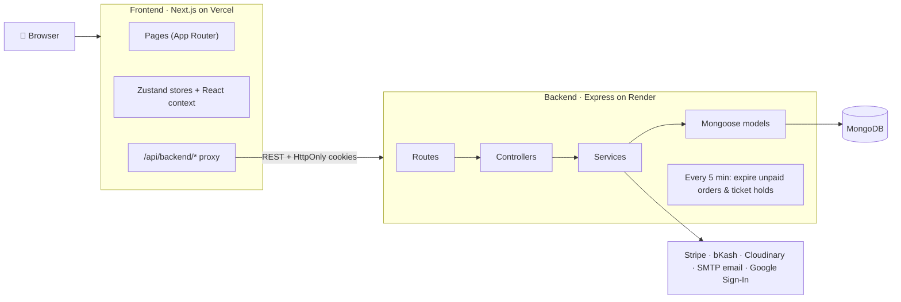

# 🛍️ SwiftCart — Full-Stack Fashion E-Commerce

A fashion store with a customer storefront, an admin panel, online payments, and AI shopping helpers.
The frontend is **Next.js** and the backend is an **Express + MongoDB** REST API.

For a complete, human-readable explanation of the project, read the [Complete Project Guide](docs/PROJECT_OVERVIEW.md). It covers the features, workflows, architecture, database, setup, configuration, testing, and current limitations.

| | Link |
| :--- | :--- |
| 🌐 **Live demo (store)** | **https://swift-e-commerce-eta.vercel.app/shop** |
| 🏠 Landing page | https://swift-e-commerce-eta.vercel.app |
| ⚙️ **Live API** | https://swift-e-commerce.onrender.com/api |
| 📘 **API docs (Swagger)** | https://swift-e-commerce.onrender.com/api-docs |

> The backend runs on Render's free tier, so the **first request after a while can take 30–60 seconds** while the server wakes up.

---

## 📌 Contents

1. [Architecture at a glance](#-architecture-at-a-glance)
2. [Tech stack](#-tech-stack)
3. [Features](#-features)
4. [Folder structure](#-folder-structure)
5. [Run it locally](#-run-it-locally)
6. [Environment variables](#-environment-variables)
7. [Tests](#-tests)
8. [More docs](#-more-docs)

---

## 🏗️ Architecture at a glance



**How a request moves:**

1. The browser only talks to the **Next.js app** (same domain).
2. Every API call goes to `/api/backend/...`. Next.js forwards it to the Express API (a rewrite in [next.config.ts](next.config.ts)). This keeps login cookies first-party.
3. Express handles it in layers: **route → middleware (auth, role, validation) → controller → service → model**.
4. Data is stored in **MongoDB**. Payments, images, emails, and Google login go to external services.
5. Login uses a short-lived **JWT access token** plus a **refresh token in an HttpOnly cookie**. [lib/apiClient.ts](lib/apiClient.ts) refreshes the token automatically.

---

## 🧰 Tech stack

| Layer | Tools |
| :--- | :--- |
| **Frontend** | Next.js 16 (App Router), React 19, TypeScript, Tailwind CSS v4, Zustand, Framer Motion, Three.js, Axios |
| **Backend** | Node.js, Express 4, Mongoose 8, JWT, bcrypt, Helmet, rate limiting, express-validator, Multer + Sharp |
| **Database** | MongoDB (Atlas in production) |
| **Integrations** | Stripe (card), bKash (mobile wallet), Cloudinary (images), Nodemailer (email), Google Identity Services |
| **Docs & tests** | Swagger UI, Node test runner, Playwright |
| **Hosting** | Vercel (frontend), Render (backend) |

---

## ✨ Features

### 🛒 Customer side
- **Shopping:** product listing with filters and sorting, product detail page, search, compare, wishlist, cart, and "save for later"
- **Checkout:** address validation, coupons, and three payment methods: **Cash on Delivery** (charge depends on the delivery zone), **Card (Stripe)**, and **bKash**
- **Account:** login/signup with email, **Google Sign-In**, or email OTP, plus optional **2FA**. Includes profile, addresses, orders, and notifications
- **Orders:** order tracking, email updates on each status change, "Pay now" for unpaid online orders, and cancellation
- **Returns & refunds:** request a return or refund on a delivered order within 7 days (`RETURN_WINDOW_DAYS`) and follow it on a return → approval → refund timeline
- **Notifications:** the bell updates right after an order and pops up anything new (status changes, refunds, messages from the store)
- **Extras:** reviews with photos, stock alerts, multi-currency and multi-language, newsletter, contact form
- **Campaigns / lucky draw:** buy tickets with bKash or card. A ticket is created only after the server confirms the payment
- **AI helpers:** chat stylist, outfit suggestions, recommendations, smart search, and a 3D **virtual dressing room** (`/dressing-room`)

### 🛡️ Admin panel (`/admin`)
- Dashboard with revenue, orders, customers, and products
- Product management: create, edit, bulk actions, CSV/JSON import and export, image uploads
- Order management: status updates, approving or rejecting **return requests**, and recording refunds (full or partial, with a payout reference). A **super admin** can override any order status and record refunds
- Staff alerts in the bell (and the store inbox) for new orders, cancellations, online payments and return requests; each one opens the order
- **Email customers** from an order or the user list: templates, optional order summary, and a history of what was sent
- Manage categories, coupons, campaigns, hero banners, currencies, languages, and support messages
- Audit trail of admin actions

---

## 📂 Folder structure

```text
Swift-E-commerce/
├── app/                 # Next.js pages (storefront, /admin, /checkout, /orders, /auth, …)
├── components/          # Reusable UI (layout, product, ui)
├── features/ai/         # AI features: avatar, chatbot, product-ai, recommendation, search
├── stores/              # Zustand state: cart, wishlist, compare, currency, language, theme
├── context/             # AuthContext, ToastContext
├── hooks/               # Custom React hooks
├── lib/                 # API client, Google login helper, utilities
├── services/            # Frontend data and AI services
├── types/               # Shared TypeScript types
├── tests/browser/       # Playwright browser tests
│
└── backend/             # Express REST API
    ├── server.js        # Entry point: connect DB, start server, start background job
    ├── scripts/         # seed.js, seedAdmin.js
    ├── tests/           # Backend tests
    └── src/
        ├── app.js       # Express setup and all /api/* routes
        ├── routes/      # URL → controller mapping
        ├── middleware/  # Auth, roles, errors
        ├── validations/ # Request validation
        ├── controllers/ # Request handlers
        ├── services/    # Business logic (payments, order quote, email, inventory, …)
        ├── models/      # MongoDB schemas (User, Product, Order, Cart, Campaign, …)
        ├── config/      # DB, env check, Cloudinary
        └── utils/       # Helpers and Swagger setup
```

### Main API groups

All routes start with `/api`. See the full list in [Swagger](https://swift-e-commerce.onrender.com/api-docs).

| Area | Routes |
| :--- | :--- |
| Auth & users | `/auth` |
| Catalog | `/products`, `/categories`, `/reviews`, `/recommendations` |
| Shopping | `/cart`, `/wishlist`, `/coupons`, `/orders`, `/payments` |
| Marketing | `/campaigns`, `/hero`, `/newsletter`, `/notifications` |
| Settings | `/currencies`, `/languages` |
| Support & AI | `/contact`, `/chat`, `/wardrobe` |
| Admin | `/admin`, `/enterprise`, `/uploads`, `/image-assets` |

---

## 🚀 Run it locally

**You need:** Node.js 20.9+ and MongoDB 6+ (local or Atlas).

```bash
# 1. Clone
git clone https://github.com/Nishat009/Swift-E-commerce.git
cd Swift-E-commerce

# 2. Install dependencies (frontend + backend)
npm install
npm --prefix backend install

# 3. Create backend/.env (see the next section)

# 4. Add demo data
npm --prefix backend run seed
npm --prefix backend run seed:admin

# 5. Start frontend and backend together
npm run dev
```

| Service | URL |
| :--- | :--- |
| Frontend | http://localhost:3001 |
| Backend API | http://localhost:5000/api |
| Swagger | http://localhost:5000/api-docs |

> On Windows PowerShell, if `npm` is blocked, use `npm.cmd run dev`.

**Demo accounts** (created by `seed:admin`):

| Role | Email | Password |
| :--- | :--- | :--- |
| Admin | `admin@email.com` | `SEED_PASSWORD` from `backend/.env` |
| Customer | `user@email.com` | `SEED_PASSWORD` from `backend/.env` |

No password is built in: if `SEED_PASSWORD` is empty, the seed picks a random one and prints it. These accounts are for local demos only; never seed them into a production database.

---

## ⚙️ Environment variables

**`backend/.env`** (required)

```env
PORT=5000
NODE_ENV=development
MONGO_URI=mongodb://127.0.0.1:27017/swiftcart
JWT_SECRET=<random string, 32+ characters>
JWT_REFRESH_SECRET=<a different random string, 32+ characters>
SEED_PASSWORD=<8+ characters, for the demo accounts>   # optional
FRONTEND_URL=http://localhost:3001
BACKEND_URL=http://localhost:5000

# Optional: each feature turns on when its keys are set
GOOGLE_CLIENT_ID=...            # Google Sign-In
STRIPE_SECRET_KEY=sk_test_...   # Card payments
BKASH_APP_KEY=...               # bKash (also BKASH_APP_SECRET, BKASH_USERNAME, BKASH_PASSWORD)
CLOUDINARY_CLOUD_NAME=...       # Image hosting (also API key/secret)
SMTP_HOST=...                   # Real email (without it, test emails use Ethereal)
```

**`.env.local`** (frontend, optional)

```env
BACKEND_API_URL=http://localhost:5000/api
NEXT_PUBLIC_APP_URL=http://localhost:3001
```

---

## 🧪 Tests

```bash
npm --prefix backend test      # Backend: auth, security, orders, lucky draw, features
npm run test:auth:browser      # Browser test for Google login (Playwright)
npm run lint                   # Lint the frontend
```

---

## 📚 More docs

| File | What it covers |
| :--- | :--- |
| [docs/google-login.md](docs/google-login.md) | Setting up Google Sign-In |
| [backend/PAYMENTS.md](backend/PAYMENTS.md) | Setting up and testing Stripe and bKash |
| [backend/EMAIL.md](backend/EMAIL.md) | Setting up email |
| [BRD.md](BRD.md) / [SRS.md](SRS.md) | Business and software requirements |

---

## 📄 License

MIT. See [LICENSE](LICENSE).
