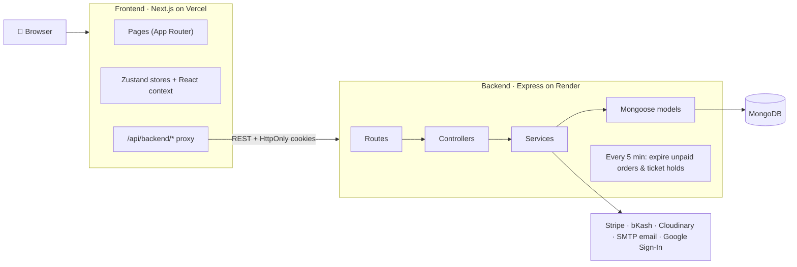

# 🛍️ SwiftCart — Full-Stack Fashion E-Commerce

A fashion store with a customer storefront, an admin panel, online payments, and AI shopping helpers.
The frontend is **Next.js** and the backend is an **Express + MongoDB** REST API.

For a complete, human-readable explanation of the project, read the [Complete Project Guide](docs/PROJECT_OVERVIEW.md). It covers the features, workflows, architecture, database, setup, configuration, testing, and current limitations.

| | Link |
| :--- | :--- |
| 🌐 **Live demo (store)** | **https://swift-e-commerce-eta.vercel.app/shop** |
| 🏠 Landing page | https://swift-e-commerce-eta.vercel.app |
| ⚙️ **Live API** | https://swift-e-commerce.onrender.com/api |
| 📘 **API docs (Swagger)** | https://swift-e-commerce.onrender.com/api-docs |

> The backend runs on Render's free tier, so the **first request after a while can take 30–60 seconds** while the server wakes up.

### 🔑 Demo access (live site)

The live site uses **one-click demo logins**, so no password is needed:

| Role | Where | What to click |
| :--- | :--- | :--- |
| Shopper | https://swift-e-commerce-eta.vercel.app/auth/login | **Guest login** |
| Admin | https://swift-e-commerce-eta.vercel.app/admin/login | **Admin login** |

Browsing the store at `/shop` needs no login at all. The demo admin can open every admin page but is
read-mostly: role changes, deletions, order status changes, customer emails, gateway tests, payment
settings and wallet adjustments are refused with "This action is disabled for demo accounts".
Locally, the seeded `admin@email.com` / `user@email.com` accounts have full access (see [HowToSetup.md](HowToSetup.md#6-demo-accounts)).

---

## 📌 Contents

1. [Architecture at a glance](#-architecture-at-a-glance)
2. [Tech stack](#-tech-stack)
3. [Features](#-features)
4. [Folder structure](#-folder-structure)
5. [Run it locally](#-run-it-locally)
6. [Environment variables](#-environment-variables)
7. [Tests](#-tests)
8. [Security](#-security)
9. [More docs](#-more-docs)

---

## 🏗️ Architecture at a glance



**How a request moves:**

1. The browser only talks to the **Next.js app** (same domain).
2. Every API call goes to `/api/backend/...`. Next.js forwards it to the Express API (a rewrite in [next.config.ts](next.config.ts)). This keeps login cookies first-party.
3. Express handles it in layers: **route → middleware (auth, role, validation) → controller → service → model**.
4. Data is stored in **MongoDB**. Payments, images, emails, and Google login go to external services.
5. Login uses a short-lived **JWT access token** plus a **refresh token in an HttpOnly cookie**. [lib/apiClient.ts](lib/apiClient.ts) refreshes the token automatically.

---

## 🧰 Tech stack

| Layer | Tools |
| :--- | :--- |
| **Frontend** | Next.js 16 (App Router), React 19, TypeScript, Tailwind CSS v4, Zustand, Framer Motion, Three.js, Axios |
| **Backend** | Node.js, Express 4, Mongoose 8, JWT, bcrypt, Helmet, rate limiting, express-validator, Multer + Sharp |
| **Database** | MongoDB (Atlas in production) |
| **Integrations** | Stripe (card), bKash (mobile wallet), Cloudinary (images), Nodemailer (email), Google Identity Services |
| **Docs & tests** | Swagger UI, Node test runner, Playwright |
| **Hosting** | Vercel (frontend), Render (backend) |

---

## ✨ Features

### 🛒 Customer side
- **Shopping:** product listing with filters and sorting, product detail page, search, compare, wishlist, cart, and "save for later"
- **Checkout:** address validation, coupons, and three payment methods: **Cash on Delivery** (charge depends on the delivery zone), **Card (Stripe)**, and **bKash**
- **Account:** login/signup with email, **Google Sign-In**, or email OTP, plus optional **2FA**. Includes profile, addresses, orders, and notifications
- **Orders:** order tracking, email updates on each status change, "Pay now" for unpaid online orders, and cancellation
- **Returns & refunds:** request a return or refund on a delivered order within 7 days (`RETURN_WINDOW_DAYS`) and follow it on a return → approval → refund timeline
- **Notifications:** the bell updates right after an order and pops up anything new (status changes, refunds, messages from the store)
- **Extras:** reviews with photos, stock alerts, multi-currency and multi-language, newsletter, contact form
- **Campaigns / lucky draw:** buy tickets with bKash or card. A ticket is created only after the server confirms the payment
- **AI helpers:** chat stylist, outfit suggestions, recommendations, smart search, and a 3D **virtual dressing room** (`/dressing-room`)

### 🛡️ Admin panel (`/admin`)
- Dashboard with revenue, orders, customers, and products
- Product management: create, edit, bulk actions, CSV/JSON import and export, image uploads
- Order management: status updates, approving or rejecting **return requests**, and recording refunds (full or partial, with a payout reference). A **super admin** can override any order status and record refunds
- Staff alerts in the bell (and the store inbox) for new orders, cancellations, online payments and return requests; each one opens the order
- **Email customers** from an order or the user list: templates, optional order summary, and a history of what was sent
- Manage categories, coupons, campaigns, hero banners, currencies, languages, and support messages
- Audit trail of admin actions

---

## 📂 Folder structure

```text
Swift-E-commerce/
├── app/                 # Next.js pages (storefront, /admin, /checkout, /orders, /auth, …)
├── components/          # Reusable UI (layout, product, ui)
├── features/ai/         # AI features: avatar, chatbot, product-ai, recommendation, search
├── stores/              # Zustand state: cart, wishlist, compare, currency, language, theme
├── context/             # AuthContext, ToastContext
├── hooks/               # Custom React hooks
├── lib/                 # API client, Google login helper, utilities
├── services/            # Frontend data and AI services
├── types/               # Shared TypeScript types
├── tests/browser/       # Playwright browser tests
│
└── backend/             # Express REST API
    ├── server.js        # Entry point: connect DB, start server, start background job
    ├── scripts/         # seed.js, seedAdmin.js
    ├── tests/           # Backend tests
    └── src/
        ├── app.js       # Express setup and all /api/* routes
        ├── routes/      # URL → controller mapping
        ├── middleware/  # Auth, roles, errors
        ├── validations/ # Request validation
        ├── controllers/ # Request handlers
        ├── services/    # Business logic (payments, order quote, email, inventory, …)
        ├── models/      # MongoDB schemas (User, Product, Order, Cart, Campaign, …)
        ├── config/      # DB, env check, Cloudinary
        └── utils/       # Helpers and Swagger setup
```

### Main API groups

All routes start with `/api`. See the full list in [Swagger](https://swift-e-commerce.onrender.com/api-docs).

| Area | Routes |
| :--- | :--- |
| Auth & users | `/auth` |
| Catalog | `/products`, `/categories`, `/reviews`, `/recommendations` |
| Shopping | `/cart`, `/wishlist`, `/coupons`, `/orders`, `/payments` |
| Marketing | `/campaigns`, `/hero`, `/newsletter`, `/notifications` |
| Settings | `/currencies`, `/languages` |
| Support & AI | `/contact`, `/chat`, `/wardrobe` |
| Admin | `/admin`, `/enterprise`, `/uploads`, `/image-assets` |

---

## 🚀 Run it locally

**You need:** Node.js 20.9+ (with npm) and MongoDB 6.0+ (tested with 8.0), either a local `mongod` that is **running before you seed** or a MongoDB Atlas connection string. Full step-by-step guide with troubleshooting: [HowToSetup.md](HowToSetup.md).

```bash
# 1. Clone
git clone https://github.com/Nishat009/Swift-E-commerce.git
cd Swift-E-commerce

# 2. Install dependencies, root (frontend) and backend. npm ci uses the committed lockfiles.
npm ci
npm --prefix backend ci

# 3. Environment files (on Windows use "copy" instead of "cp")
cp backend/.env.example backend/.env    # required
cp .env.example .env.local              # optional (frontend defaults work locally)

# 4. Generate the two REQUIRED secrets and paste them into backend/.env as
#    JWT_SECRET=... and JWT_REFRESH_SECRET=... (the server refuses to start without them)
node -e "console.log(require('crypto').randomBytes(48).toString('hex'))"
node -e "console.log(require('crypto').randomBytes(48).toString('hex'))"
#    MONGO_URI defaults to mongodb://127.0.0.1:27017/swiftcart; change it for Atlas.

# 5. Create the collections and indexes, then add demo data
npm --prefix backend run db:init
npm --prefix backend run seed
npm --prefix backend run seed:admin    # demo admin + customer accounts

# 6. Start frontend (port 3001) and backend (port 5000) together
npm run dev
```

The frontend runs on **3001**, not Next.js's usual 3000 (`next dev -p 3001`); `FRONTEND_URL` in `backend/.env` already matches. On first start the backend also adds the fashion catalog if the database has no public product (`AUTO_SEED_CATALOG=false` turns that off).

| Service | URL |
| :--- | :--- |
| Frontend | http://localhost:3001 |
| Backend API | http://localhost:5000/api |
| Swagger | http://localhost:5000/api-docs |

> On Windows PowerShell, if `npm` is blocked, use `npm.cmd run dev`.

**Demo accounts** (created by `seed:admin`):

| Role | Email | Password |
| :--- | :--- | :--- |
| Admin | `admin@email.com` | `SEED_PASSWORD` from `backend/.env` |
| Customer | `user@email.com` | `SEED_PASSWORD` from `backend/.env` |

No password is built in: if `SEED_PASSWORD` is empty, the seed picks a random one and prints it. These accounts are for local demos only; never seed them into a production database.

---

## ⚙️ Environment variables

**`backend/.env`** (required)

```env
PORT=5000
NODE_ENV=development
MONGO_URI=mongodb://127.0.0.1:27017/swiftcart
JWT_SECRET=<random string, 32+ characters>
JWT_REFRESH_SECRET=<a different random string, 32+ characters>
SEED_PASSWORD=<8+ characters, for the demo accounts>   # optional
FRONTEND_URL=http://localhost:3001
BACKEND_URL=http://localhost:5000

# Optional: each feature turns on when its keys are set
GOOGLE_CLIENT_ID=...            # Google Sign-In
STRIPE_SECRET_KEY=sk_test_...   # Card payments
BKASH_APP_KEY=...               # bKash (also BKASH_APP_SECRET, BKASH_USERNAME, BKASH_PASSWORD)
CLOUDINARY_CLOUD_NAME=...       # Image hosting (also API key/secret)
SMTP_HOST=...                   # Real email (without it, test emails use Ethereal)
```

**`.env.local`** (frontend, optional)

```env
BACKEND_API_URL=http://localhost:5000/api
NEXT_PUBLIC_APP_URL=http://localhost:3001
```

---

## 🧪 Tests

```bash
npm --prefix backend test      # Backend: auth, security, orders, lucky draw, features, route guards (75 tests)
npm --prefix backend run test:routes   # Only the route-guard policy check
npm run test:auth:browser      # Browser test for Google login (Playwright)
npm run lint                   # Lint the frontend
```

`npm --prefix backend test` needs a running MongoDB (it uses its own `swiftcart_*_test` databases and
drops them afterwards). Two end-to-end checks run against a **running local backend** instead and are
not part of `npm test`: start the API (`npm --prefix backend run dev`), set `TEST_ADMIN_PASSWORD` (or
`SEED_PASSWORD`) to the seeded admin's password, then run `npm --prefix backend run test:live`
(`TEST_API_URL` defaults to `http://localhost:5000/api`). They remove everything they create.

---

## 🔒 Security

### Who can call what

Every route that creates, changes or deletes data requires a signed-in user (`protect`), and every
store-management route also requires `authorize('admin')`. This is enforced by a test:
[backend/tests/route-guards.test.js](backend/tests/route-guards.test.js) walks every router and fails if a
POST/PUT/PATCH/DELETE route is missing its guard or is not on the explicit public / signed-in list.

| Routers | Guard |
| :--- | :--- |
| `admin`, `languages` | `router.use(protect)` + `router.use(authorize('admin'))` on the whole router |
| `cart`, `wishlist`, `wardrobe`, `orders` | `router.use(protect)` on the whole router; order status, returns decisions and refunds add `authorize('admin')` (refunds and status overrides also need a super admin) |
| `products`, `categories`, `coupons`, `currencies`, `hero`, `campaigns`, `uploads`, `image-assets` | Reads are public; every write has `protect, authorize('admin')`, except buying a campaign ticket (`protect`) and the public, rate-limited back-in-stock alert |
| `reviews`, `notifications` | Every write has `protect` |
| `chat`, `contact`, `newsletter` | Public send/subscribe (rate-limited); reading and managing messages needs `protect, authorize('admin')` |
| `auth` | Sign-in, register, OTP and password reset are public and rate-limited; profile, 2FA and Google linking need `protect` |
| `payments` | Starting a payment needs `protect`; gateway callbacks and the Stripe webhook are public by design (below) |

Records that belong to a customer are checked against the signed-in user: orders (view, cancel, pay,
return), reviews (edit, delete), notifications, cart, wishlist and wardrobe. Another customer's record
answers 404 or 403. All rate limits live in [backend/src/config/rateLimits.js](backend/src/config/rateLimits.js).

### Sessions

Access tokens live 15 minutes. The refresh token is an httpOnly cookie backed by a server-side session
([backend/src/services/refreshSessions.js](backend/src/services/refreshSessions.js)): only a SHA-256 of its
one-time secret is stored, every refresh rotates it, logout revokes it, and replaying an old token
revokes all of that user's sessions and access tokens. Changing the password signs out other devices.
`/auth/refresh` and `/auth/logout` are rate-limited. Deleting a customer removes their sessions, cart,
wishlist, wardrobe, notifications, stock alerts and sign-in challenges; orders, reviews and tickets are
kept as store records.

### Payments

- The Stripe webhook is accepted only with a valid `Stripe-Signature` (HMAC-SHA256 over the raw body with `STRIPE_WEBHOOK_SECRET`, 5-minute tolerance).
- bKash callbacks and Stripe returns never trust the status in the URL: the order is marked paid only after the server asks the gateway (bKash execute/query, Stripe session retrieve) and the paid amount matches the order total.
- The mock gateway exists only when `PAYMENT_MOCK=true` and `NODE_ENV` is not `production`.
- Gateway keys saved in **Admin → Payment Settings** are encrypted with AES-256-GCM using `PAYMENT_SETTINGS_KEY` (required in production, never returned to the browser).

### Demo accounts

The one-click demo admin can view the admin panel but cannot change roles, delete users, change order
status, read or send customer emails, export the wallet statement, test gateways, change payment
settings or adjust the wallet. Everything it is sent has customer emails, phone numbers, street
addresses, IPs and surnames masked ([backend/src/middleware/demoPrivacy.js](backend/src/middleware/demoPrivacy.js)).
A real admin account has none of these limits.

### Stored personal data

Chat messages keep only a keyed hash of the sender's IP and are deleted automatically after
`CHAT_RETENTION_DAYS` (default 180). The admin chat inbox needs `protect, authorize('admin')`; a customer
reads only their own chat history, and guests cannot read any.

### Dependencies

`npm audit` (including dev dependencies) reports **0 vulnerabilities** for both the frontend and the
backend as of 2026-10-28 (Next.js 16.4.3, React 19.2, Express 4.22.3, helmet 8.3, bcryptjs 3.0, multer 2.5,
nodemailer 10.2, sharp 0.35, jsonwebtoken 9.0). No dependency uses `*` or `latest`. Express stays on
the patched 4.x line; moving to Express 5 is planned separately. Both packages commit a `package-lock.json`; use `npm ci` for deploys. Re-check with:

```bash
npm audit && npm --prefix backend audit
```

---

## 📚 More docs

| File | What it covers |
| :--- | :--- |
| [docs/google-login.md](docs/google-login.md) | Setting up Google Sign-In |
| [backend/PAYMENTS.md](backend/PAYMENTS.md) | Setting up and testing Stripe and bKash |
| [backend/EMAIL.md](backend/EMAIL.md) | Setting up email |
| [BRD.md](BRD.md) / [SRS.md](SRS.md) | Business and software requirements |

---

## 📄 License

MIT. See [LICENSE](LICENSE).
