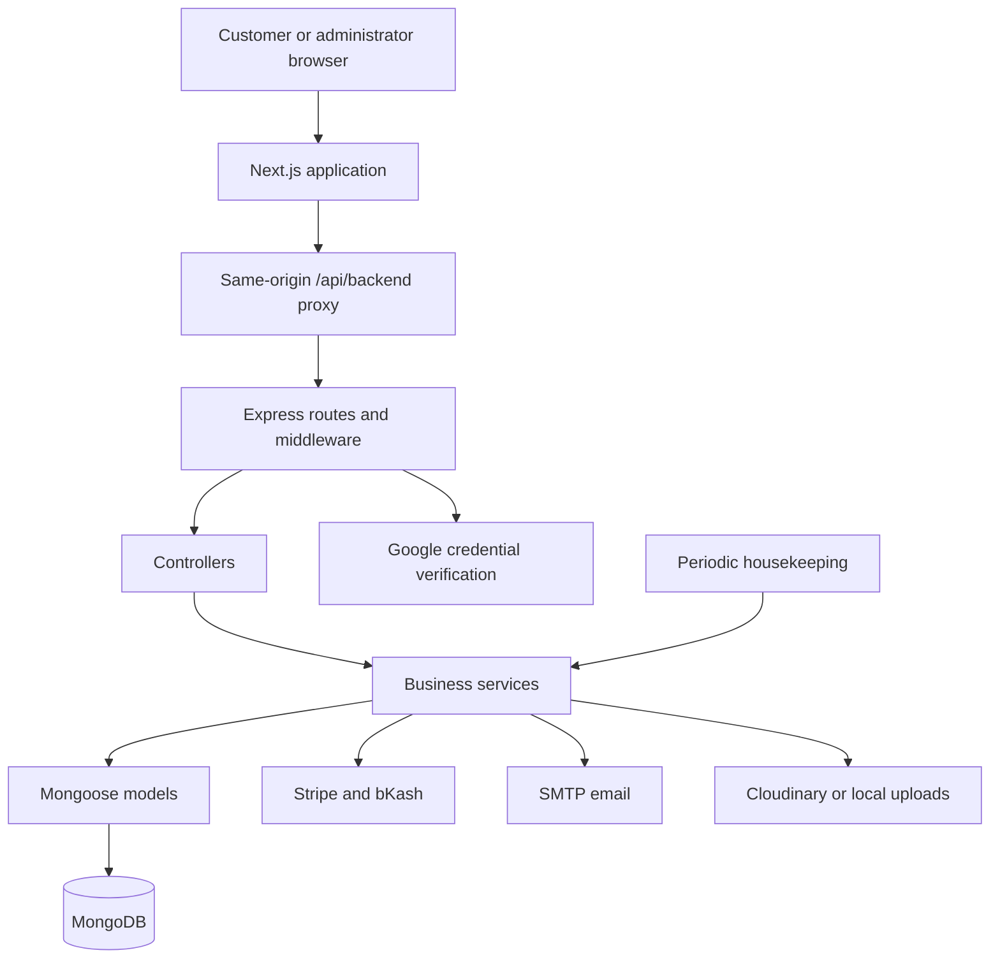

# SwiftCart: Complete Project Guide

> A human-readable guide to the project's purpose, features, architecture, workflows, setup, and current limitations. This document describes the source code in this repository; external services still require their own configuration.

## Contents

1. [Project introduction](#1-project-introduction)
2. [The problem and the proposed solution](#2-the-problem-and-the-proposed-solution)
3. [Objectives and scope](#3-objectives-and-scope)
4. [Users and permissions](#4-users-and-permissions)
5. [Customer shopping experience](#5-customer-shopping-experience)
6. [Accounts and authentication](#6-accounts-and-authentication)
7. [Cart, checkout, and pricing](#7-cart-checkout-and-pricing)
8. [Payments and payment verification](#8-payments-and-payment-verification)
9. [Orders, cancellations, returns, and refunds](#9-orders-cancellations-returns-and-refunds)
10. [Campaigns and lucky draws](#10-campaigns-and-lucky-draws)
11. [Shopping assistants and recommendations](#11-shopping-assistants-and-recommendations)
12. [Virtual dressing room](#12-virtual-dressing-room)
13. [Administration and store operations](#13-administration-and-store-operations)
14. [Email, notifications, and customer support](#14-email-notifications-and-customer-support)
15. [Technology stack](#15-technology-stack)
16. [System architecture](#16-system-architecture)
17. [Database design](#17-database-design)
18. [Pages and API organization](#18-pages-and-api-organization)
19. [Repository structure](#19-repository-structure)
20. [Local installation](#20-local-installation)
21. [Environment configuration](#21-environment-configuration)
22. [Testing and verification](#22-testing-and-verification)
23. [Deployment and operation](#23-deployment-and-operation)
24. [Security and reliability](#24-security-and-reliability)
25. [Current limitations and future development](#25-current-limitations-and-future-development)
26. [Presentation-ready project description](#26-presentation-ready-project-description)
27. [Further reading and license](#27-further-reading-and-license)

## 1. Project introduction

**SwiftCart is a full-stack e-commerce web application with a fashion-focused storefront and an administrative workspace.** Customers can discover products, compare options, save favorites, place orders, make payments, and manage their accounts. Store staff can manage the catalog, process orders, communicate with customers, and review business activity.

The project also includes a virtual dressing room, shopping assistants, product recommendations, and paid campaign tickets. These features extend the shopping experience beyond a basic product listing and checkout.

Although fashion is a major focus, the catalog structure and seed data also accommodate home and lifestyle products, including furniture, lighting, and decor.

The application has two main parts:

- **Frontend:** a Next.js application that provides the storefront, account pages, and administration interface.
- **Backend:** an Express REST API that manages authentication, business rules, database access, payments, and notifications.

MongoDB stores the application's persistent data. External services support Google Sign-In, card payments, bKash payments, image hosting, and email delivery when configured.

## 2. The problem and the proposed solution

Online shopping involves more than choosing a product. Customers need enough information to make a decision, confidence in the checkout total, a suitable payment method, and a way to follow up after purchase. Store owners need tools to keep stock accurate, process orders, and answer customer questions.

SwiftCart brings these activities into one application. Product filters, reviews, comparison tools, and outfit suggestions support discovery. Server-calculated checkout totals and payment verification support ordering. Order history, return requests, notifications, and customer email tools support the relationship after purchase.

For store staff, the administrative interface connects catalog management, customer orders, financial records, support messages, and activity logs.

## 3. Objectives and scope

The main objectives are to:

1. Provide a clear shopping experience across desktop and mobile layouts.
2. Help customers find suitable products through search, filtering, comparisons, and recommendations.
3. Support email-based accounts, Google Sign-In, and optional two-factor authentication.
4. Calculate prices, discounts, delivery charges, and stock availability on the server.
5. Support cash on delivery, card payments, and bKash through separate payment flows.
6. Manage the order lifecycle, including cancellation, returns, and refund records.
7. Give administrators practical tools for daily store operations.
8. Keep a record of significant actions for troubleshooting and review.

The repository represents a store application with customer and administrator roles. It does not define a separate seller role or a marketplace payout system.

## 4. Users and permissions

| User type | Typical activities |
| --- | --- |
| Visitor | Browse public products, search the catalog, inspect product details, use local shopping tools, and interact with the stylist. |
| Customer | Place orders, pay online, manage addresses, save account data, review orders, and request eligible returns. |
| Administrator | Manage products, categories, orders, campaigns, customers, support messages, and store settings. |
| Super administrator | Perform restricted actions such as order status overrides, refund confirmation, and manual wallet adjustments. |

The database defines two account roles: `customer` and `admin`. A super administrator is a non-demo administrator who passes the additional permission check. When `SUPER_ADMIN_EMAILS` is configured, only listed administrator emails pass that check. Without that setting, all non-demo administrators qualify.

Optional demo login buttons provide access to fixed demonstration accounts. Demo accounts have restrictions on selected sensitive actions, but enabling an administrator demo button still exposes administrative access to visitors.

## 5. Customer shopping experience

### Product discovery

Customers can explore the catalog through product listings, categories, search, filters, and sorting. Product information includes prices, images, descriptions, stock, and relevant variant options.

The backend also provides autocomplete, trending search terms, and spelling suggestions. Its spelling correction uses edit distance: it compares the customer's words with words collected from the catalog and suggests close matches.

### Product details and decision tools

Product pages bring together image galleries, available variants, quantity selection, reviews, and purchase actions. Supporting tools include product comparisons, outfit suggestions, and back-in-stock subscriptions.

The comparison interface supports up to three products. Customers can inspect differences in attributes such as price, category, brand, stock, and specifications.

### Wishlists and reviews

Wishlists support saved products, collections, sharing links, and alert preferences. Customers can move saved products into their cart. Product alert services support restock and price-drop notifications.

Reviews support ratings, comments, photo references, and helpful votes. The backend prevents duplicate reviews for the same user and product.

### Display preferences

Zustand stores preserve preferences such as theme, currency, and selected language. Currency settings use rates provided by the backend. Language configuration and selection are present, but selecting a language should not be interpreted as proof that every interface string has a translation.

## 6. Accounts and authentication

SwiftCart supports several account access flows:

- Email and password registration and login.
- Google Sign-In and linking Google to an existing account.
- Email OTP login.
- Password reset.
- Optional authenticator-based two-factor authentication and recovery codes.
- Session refresh and logout.

Passwords are hashed with bcrypt before storage. Private authentication fields are excluded from the public user representation.

Google credentials are verified by the backend. The flow uses Google Identity Services and a public OAuth client ID; its setup does not require a Google client secret.

Authentication uses JWT access tokens and refresh tokens. The application supports an HttpOnly refresh cookie, while the frontend API client also contains browser-storage token handling and a refresh-token body fallback. These details matter when reviewing session security.

When an authenticated API request receives an eligible `401` response, the frontend attempts to refresh the session and retry the request. Requests waiting for that refresh are resolved or rejected together. Password changes invalidate older sessions through a token version field.

Customer account pages provide access to profile information, shipping addresses, orders, wishlists, and settings. Guest cart items can be merged into the account cart after login.

## 7. Cart, checkout, and pricing

The cart stores selected products, variants, and quantities. Checkout collects a shipping address and payment method, then asks the backend for an order quote.

**The backend calculates the order total from database values.** It checks that products are public and published, validates quantities, checks product and variant stock, and evaluates coupons. A browser-supplied price is not the final authority.

Current pricing rules in `backend/src/services/orderQuote.js` are:

| Rule | Current behavior |
| --- | --- |
| Base currency | USD. |
| Tax calculation | 10% of the merchandise amount remaining after coupon and automatic promotion discounts. |
| Automatic promotion | $30 off a merchandise subtotal of $300 or more, subject to the remaining subtotal. |
| Free delivery | A merchandise subtotal of $100 or more qualifies before coupon and automatic promotion deductions. |
| Standard card or bKash delivery | $10 below the free-delivery threshold. |
| COD inside Dhaka | BDT 60 by default, converted into USD. |
| COD outside Dhaka | BDT 120 by default, converted into USD. |
| Default BDT conversion | BDT 120 per USD, configurable through `BDT_PER_USD`. |
| Quantity validation | Whole numbers from 1 to 50 per order line. |

Cash-on-delivery checkout requires a delivery zone. The backend also checks whether an inside-Dhaka selection agrees with the address city.

For example, an order with a $300 merchandise subtotal and no coupon receives the $30 automatic promotion and free delivery. Tax is $27 on the remaining $270, producing a final total of **$297**.

These figures describe application rules. Tax, promotion, and shipping values should be reviewed against the store's actual policies before operating the shop.

## 8. Payments and payment verification

| Method | How it works |
| --- | --- |
| Cash on delivery | The customer places an order and pays through the store's delivery process. |
| Card | The backend creates a Stripe Checkout session and verifies the resulting payment. |
| bKash | The backend starts a tokenized checkout flow and verifies its result. |

The frontend can request the payment methods currently available from `/api/payments/methods`. Online methods depend on their corresponding backend credentials.

A typical online order follows this sequence:

1. The customer submits a validated order.
2. The backend creates an unpaid order and reserves the required stock.
3. The customer starts payment and follows the gateway redirect.
4. The backend verifies the gateway result before applying a successful payment.
5. The application updates the order and sends the relevant notifications.

The API includes bKash callbacks, card return handling, and a Stripe webhook endpoint. The webhook secret is used when configuring Stripe webhook verification.

For local demonstrations, `PAYMENT_MOCK=true` enables a simulated gateway. Production ignores this mock setting. Simulated payments do not represent real transactions.

Unpaid online orders have a default 30-minute payment hold. A housekeeping task checks for expired holds at startup and every five minutes, so cleanup happens when the sweep runs rather than at the exact expiration second.

## 9. Orders, cancellations, returns, and refunds

### Order lifecycle

The order model supports `Pending`, `Processing`, `Confirmed`, `Packed`, `Shipped`, `Delivered`, `Cancelled`, and `Returned` statuses.

A typical successful path is:

```text
Pending -> Confirmed -> Packed -> Shipped -> Delivered
```

Some permitted paths include a processing stage. Normal administrative updates follow transition rules, and unpaid online orders cannot advance to packing, shipping, or delivery. A super administrator has a separate override operation with additional handling rules.

Customers can cancel eligible orders while they are pending, processing, or confirmed. Cancellation releases stock and applicable coupon usage. A paid order that requires money to be returned is marked for refund handling.

### Returns

Customers can request returns for delivered orders within `RETURN_WINDOW_DAYS`, which defaults to seven days. The request records a reason and supporting details.

For a paid return, staff can propose a refund amount with an explanation. The customer can accept or decline the offer. Staff can revise an offer when appropriate, and a super administrator can confirm an accepted refund.

The default policy gives a full refundable amount for requests made within three days of delivery. Later eligible requests can carry a suggested 15% handling deduction. These values are configurable through `FULL_REFUND_DAYS` and `LATE_RETURN_FEE_PERCENT`.

For this return calculation, the refundable starting amount is the order total minus shipping. This includes any tax already contained in that total. Shipping is excluded from the proposed return refund.

### Refund records and the store wallet

Refund confirmation records the amount, reference, notes, timing, and staff action. The internal store wallet tracks sale credits, refund debits, and manual adjustments, and a refund debit requires sufficient recorded balance.

**The internal wallet is an application ledger.** Recording or confirming a refund does not automatically send funds through Stripe or bKash. The current controller explicitly leaves gateway payouts to an external process, such as the payment provider's dashboard.

The wallet defaults to an opening balance of $50,000 for demonstrations unless `STORE_WALLET_OPENING_BALANCE` is set before its first creation. That value is a database opening entry, not money deposited into a payment account.

## 10. Campaigns and lucky draws

Campaign pages let customers inspect available draws, purchase tickets, and review their issued tickets. Administrators can create campaigns, manage status and ticket limits, inspect participation, conduct a draw, and record prize delivery evidence.

Ticket purchases use an online payment flow:

1. The backend checks campaign availability and ticket limits.
2. It creates a temporary ticket purchase hold.
3. The customer completes an available card or bKash payment.
4. The backend verifies payment and issues tickets.
5. Failed or expired purchases release their holds.

A draw is blocked while relevant payments remain in flight. The winner is selected on the server from issued tickets using Node's cryptographic random selection. The draw is claimed atomically to prevent duplicate execution.

Winner and participant notifications, a winners listing, optional recording links, and prize delivery proof support follow-up after the draw.

## 11. Shopping assistants and recommendations

Several interfaces use the term AI. Their current implementations are mainly rules, catalog matching, scoring, and templates.

| Feature | Current implementation |
| --- | --- |
| Chat stylist | Parses product, outfit, season, occasion, color, gender, and budget cues, then recommends matching catalog items. |
| Outfit planning | Groups clothing by outfit role and scores combinations against constraints such as a total budget and season. |
| Smart search | Extracts supported search cues and filters catalog products; the backend also provides spelling correction and suggestions. |
| Recommendations | Uses categories from orders and wishlists, product ratings, and catalog flags; frontend helpers also use stored preferences. |
| Complete-the-look suggestions | Chooses complementary product categories around a selected item. |
| Review analysis | Groups reviews by rating to calculate positive, neutral, and negative percentages. |
| Product copy drafting | Generates editable title, description, tags, and SEO text from a template using supplied product attributes. |
| Image asset presets | Uses Sharp on the backend to create cropped and resized WebP images for product cards and banners. |

For example, a customer can ask for a summer office outfit under a stated budget. The stylist attempts to choose compatible clothing while excluding unsuitable seasonal pieces and keeping the outfit within that budget.

The current source does not integrate an external large language model for these helpers. Recommendation quality depends on catalog coverage and metadata. A section labeled "Because You Viewed" in the backend is populated from preferred categories derived from orders and wishlists, rather than a separate browsing-history model.

## 12. Virtual dressing room

The `/dressing-room` page provides an interactive Three.js fitting view. Customers can select supported catalog garments, combine clothing layers, change the mannequin presentation, inspect the scene, and add selected catalog pieces to the cart.

The page supports dresses, tops, jackets, trousers, and skirts. It also accepts local clothing images for preview. Garment visuals are built from image analysis and procedural geometry around a mannequin.

The 3D component loads dynamically after the page begins rendering, which reduces the initial loading work for the rest of the page. Scene controls support inspection through rotation and zoom.

This is a visual preview rather than a measurement-accurate fit prediction or a photorealistic try-on system. Image quality and accessibility affect the result. Remote images must be readable by the browser canvas or load through the configured image proxy.

A separate `/api/avatar` route currently returns `503` because its Ready Player Me proxy is disabled. The active dressing room uses its own mannequin renderer, so the disabled avatar endpoint should not be confused with the current fitting view.

The backend also includes wardrobe persistence and challenge endpoints. Their presence does not imply that every wardrobe feature is exposed by the current dressing-room page.

## 13. Administration and store operations

The main administration route is `/admin`. Dedicated product management pages also exist under `/dashboard/products`.

### Catalog management

Administrators can create and edit products, manage images and variants, configure pricing and inventory, organize categories, and control publication. Product tools include bulk actions, duplication, import, and export.

Product information covers business-facing details such as SKU, descriptions, pricing, specifications, stock, media, SEO fields, and publication state. Cloudinary can provide persistent upload hosting; local server storage is the fallback.

### Orders and customers

Staff can inspect orders, update permitted statuses, handle return requests, propose refunds, and send customer emails. Customer tools include account listings, role management, and inspection of saved carts and wishlists where authorized.

### Marketing, settings, and reporting

Administrative tools cover coupons, hero content, campaigns, currency configuration, language entries, contact messages, and stylist chat messages.

Dashboard and reporting interfaces expose store figures and activity. Accounts tools provide wallet transactions and CSV statements. Enterprise endpoints provide activity logs, request logs, entity audit history, and monitoring statistics.

The internal ledger and reports describe application records; they do not constitute a bank reconciliation or a complete external accounting system.

## 14. Email, notifications, and customer support

SwiftCart uses both stored in-app notifications and email messages.

Notifications cover events such as order changes, payment updates, returns, refund offers, stock alerts, and campaign outcomes. Staff also receive alerts for events requiring attention.

Nodemailer handles email. With SMTP configured, messages can be delivered through the chosen provider. In development, the email service can use Ethereal test inboxes and print preview links. Test previews do not deliver messages to the customer's real inbox.

Customer-facing email flows include order confirmations, order updates, OTPs, password resets, and other configured messages. Staff can send templated or custom emails from customer or order views, optionally include order information, and inspect message history.

The contact form and chat message records give staff additional ways to review customer inquiries. Live human-agent chat delivery is not established by the stored stylist message interface.

## 15. Technology stack

Versions below describe the repository manifests, not a promise about future releases.

| Area | Main technologies | Purpose |
| --- | --- | --- |
| Frontend framework | Next.js 16.0.7, React 19.2.0 | Pages, layouts, client interaction, and server routing. |
| Frontend language | TypeScript | Types for components, API data, and application state. |
| Styling | Tailwind CSS 4 | Styling and responsive layouts. |
| UI and motion | Framer Motion, Lucide, React Icons | Animation and interface icons. |
| State | Zustand, React Context | Shopping state, preferences, authentication, and toast messages. |
| HTTP client | Axios | API requests and session refresh handling. |
| 3D | Three.js | Mannequin, clothing visualization, lighting, and camera controls. |
| Backend | Node.js, Express 4 | REST API and business logic. |
| Database | MongoDB, Mongoose 8 | Persistence, schemas, references, and indexes. |
| Authentication | JWT, bcryptjs, Google Auth Library | Sessions, password hashing, and Google credential verification. |
| API protection | Helmet, express-rate-limit, express-validator | Headers, request limits, and input validation. |
| Media | Multer, Sharp, Cloudinary | Upload handling, image processing, and optional hosted storage. |
| Email | Nodemailer | SMTP delivery and development previews. |
| Documentation | Swagger JSDoc, Swagger UI | Interactive API documentation in non-production environments. |
| Verification | Node test runner, Playwright, ESLint | Backend tests, browser tests, and frontend linting. |

## 16. System architecture



The frontend's API client sends application requests to `/api/backend`. A Next.js rewrite forwards these requests to the Express API. This gives the browser a consistent application API origin and helps with cookie handling. External sign-in, payment redirects, and image resources still involve their respective services.

The backend generally separates responsibilities into routes, middleware, controllers, services, and models. Some smaller route modules handle their logic directly.

For example, during checkout, authentication middleware identifies the customer, validation checks the request, a controller coordinates order creation, pricing and inventory services apply business rules, and Mongoose writes the resulting records.

## 17. Database design

MongoDB stores related documents through Mongoose models and references.

| Data area | Main models | What they represent |
| --- | --- | --- |
| Identity | `User`, `AuthChallenge` | Accounts, addresses, authentication state, and sign-in challenges. |
| Catalog | `Product`, `Category`, `Review`, `StockAlert` | Products, grouping, feedback, and availability subscriptions. |
| Shopping | `Cart`, `Wishlist`, `Coupon` | Selected products, saved collections, and promotion rules. |
| Orders | `Order` | Purchased line snapshots, totals, delivery details, payment state, returns, and refunds. |
| Campaigns | `Campaign`, `TicketPurchase`, `Ticket` | Campaign definitions, payment holds, and issued participation tickets. |
| Communication | `Notification`, `ContactMessage`, `ChatMessage`, `CustomerEmail`, `Newsletter` | Alerts, inquiries, stylist conversations, email history, and subscriptions. |
| Configuration | `Currency`, `Language`, `HeroSlide` | Currency display, language options, and promotional page content. |
| Wardrobe | `Wardrobe` | Saved avatar and outfit-related data and challenge progress. |
| Finance | `StoreWallet`, `WalletTransaction` | Internal account balance and credit/debit history. |
| Operations | `ActivityLog`, `AuditTrail`, `RequestLog`, `SearchTerm` | Actions, entity changes, request records, and search activity. |

A user can have addresses, orders, a cart, a wishlist, and notifications. Products connect to order lines, cart items, reviews, and alerts. Campaigns connect to temporary purchases and issued tickets. Wallet entries can reference orders.

Orders preserve purchased titles, unit prices, quantities, variants, and totals so the order record does not rely entirely on a product's later catalog state.

## 18. Pages and API organization

### Main pages

| Route | Purpose |
| --- | --- |
| `/` | Storefront home. |
| `/products` | Catalog browsing and filtering. |
| `/product/[id]` | Individual product details. |
| `/cart`, `/checkout` | Shopping bag and order placement. |
| `/auth/login`, `/auth/register` | Account access and registration. |
| `/dashboard`, `/profile`, `/addresses`, `/settings` | Customer account tools. |
| `/orders`, `/wishlist` | Purchase history and saved products. |
| `/wishlist/shared/[token]` | Public shared wishlist. |
| `/dressing-room` | Interactive clothing preview. |
| `/campaigns`, `/campaigns/[id]`, `/campaigns/my-tickets` | Campaign discovery and participation. |
| `/admin` | Main administration workspace. |
| `/dashboard/products`, `/dashboard/products/create`, `/dashboard/products/[id]/edit` | Product administration. |
| `/about`, `/contact`, `/faq`, `/shipping-returns`, `/privacy`, `/terms` | Store information, help, and policy pages. |

### API groups

All groups below use the backend `/api` prefix. Browser application calls normally reach them through `/api/backend` on Next.js.

| Group | Responsibility |
| --- | --- |
| `/auth` | Registration, login, Google verification, session refresh, OTP, 2FA, profile, and addresses. |
| `/products`, `/categories`, `/reviews` | Catalog, search support, product alerts, categories, and reviews. |
| `/cart`, `/wishlist`, `/coupons` | Shopping state and promotion handling. |
| `/orders`, `/payments` | Quotes, orders, returns, refunds, gateway sessions, callbacks, and webhook handling. |
| `/campaigns` | Campaigns, ticket purchases, draws, and delivery evidence. |
| `/notifications`, `/newsletter`, `/contact`, `/chat` | Communication and subscriptions. |
| `/recommendations`, `/wardrobe` | Product suggestions and wardrobe data. |
| `/admin`, `/enterprise` | Store operations, accounts, reports, monitoring, and logs. |
| `/hero`, `/currencies`, `/languages` | Store content and preferences. |
| `/uploads`, `/image-assets` | Media-related operations. |
| `/health` | Basic API health response. |

Representative endpoints include `POST /api/orders/quote`, `POST /api/orders`, `POST /api/payments/orders/:orderId/initiate`, and `POST /api/orders/:id/return-request`.

Swagger UI is mounted at `/api-docs` when `NODE_ENV` is not `production`. Check route source files for the precise implementation of an endpoint; the documentation annotations may not describe every route.

## 19. Repository structure

```text
Swift-E-commerce/
|-- app/                    Next.js pages, layouts, and frontend API routes
|-- components/             Shared UI and feature components
|   |-- admin/              Store administration
|   |-- auth/               Sign-in and two-factor interfaces
|   |-- dressing-room/      Three.js fitting view and garment geometry
|   |-- layout/             Navigation, footer, and account layouts
|   |-- orders/             Return and refund interfaces
|   |-- product/            Product forms, galleries, variants, and reviews
|   `-- ui/                 Reusable interface elements
|-- features/ai/            Shopping helpers and related interfaces
|-- context/                Authentication and toast providers
|-- stores/                 Zustand shopping and preference stores
|-- hooks/                  Catalog, quote, avatar, and recommendation hooks
|-- lib/                    API client, authentication helpers, and site settings
|-- services/               Frontend product and shopping helper services
|-- types/                  TypeScript data definitions
|-- utils/                  Shared frontend utilities
|-- data/                   Catalog and demonstration data
|-- public/                 Static assets
|-- docs/                   Supporting documentation
|-- tests/browser/          Playwright authentication tests
|-- scripts/                Frontend setup helpers
`-- backend/
    |-- server.js           Startup, database connection, and housekeeping
    |-- .env.example        Backend configuration template
    |-- scripts/            Seed and maintenance scripts
    |-- tests/              Backend tests and separate live-check scripts
    `-- src/
        |-- app.js          Express configuration and route registration
        |-- config/         Environment, database, and image-host configuration
        |-- routes/         API route definitions
        |-- middleware/     Authentication, authorization, uploads, and errors
        |-- validations/    Request validation rules
        |-- controllers/    Request coordination and responses
        |-- services/       Pricing, inventory, payments, email, and other logic
        |-- models/         Mongoose schemas
        `-- utils/          Tokens, metrics, activity logging, and helpers
```

## 20. Local installation

### Requirements

Use Node.js **20.9.0 or newer**, npm, and a reachable MongoDB instance. The Node minimum comes from the installed Next.js 16 package. External credentials are needed only for the integrations you intend to use.

### Step 1: Install dependencies

From the repository root:

```bash
npm install
npm --prefix backend install
```

### Step 2: Configure the backend

Copy `backend/.env.example` to `backend/.env`. In PowerShell:

```powershell
Copy-Item backend/.env.example backend/.env
```

Set `MONGO_URI`, `JWT_SECRET`, and `JWT_REFRESH_SECRET`. Both secrets must contain at least 32 characters and should be different. The backend validates their length before startup.

For a local database, the template uses:

```env
PORT=5000
NODE_ENV=development
MONGO_URI=mongodb://127.0.0.1:27017/swiftcart
FRONTEND_URL=http://localhost:3001
BACKEND_URL=http://localhost:5000
```

### Step 3: Optionally configure the frontend

Create `.env.local` in the repository root if you need to override the defaults:

```env
BACKEND_API_URL=http://localhost:5000/api
```

### Step 4: Optionally load demonstration data

```bash
npm --prefix backend run seed
npm --prefix backend run seed:admin
```

**Use a disposable local database for seeding.** The main seed script deletes existing users, products, categories, coupons, and reviews. The administrator seed script creates or resets fixed accounts and their passwords. These scripts refuse production mode and require an explicit override for remote databases.

The fixed local accounts created by `seed:admin` are:

| Role | Email | Password |
| --- | --- | --- |
| Administrator | `admin@email.com` | `SEED_PASSWORD` from `backend/.env` |
| Customer | `user@email.com` | `SEED_PASSWORD` from `backend/.env` |

No password is built into the code: when `SEED_PASSWORD` is empty, the seed generates a random one and prints it. These credentials are for local demonstrations.

### Step 5: Start the application

```bash
npm run dev
```

This starts the frontend and backend together. To start them separately in two terminals:

```bash
npm run dev:frontend
npm run dev:backend
```

| Service | Local URL |
| --- | --- |
| Storefront | `http://localhost:3001` |
| Backend API | `http://localhost:5000/api` |
| Health check | `http://localhost:5000/api/health` |
| Development API documentation | `http://localhost:5000/api-docs` |

On Windows, use `npm.cmd` if PowerShell blocks the npm script entry point.

## 21. Environment configuration

The backend template is [backend/.env.example](../backend/.env.example). The table also includes selected settings read by the source that are not listed in that template.

| Configuration | Variables | Purpose |
| --- | --- | --- |
| Core backend | `PORT`, `NODE_ENV`, `MONGO_URI`, `FRONTEND_URL`, `BACKEND_URL` | Runtime, database, permitted origins, and public backend links. |
| Session secrets | `JWT_SECRET`, `JWT_REFRESH_SECRET` | Signing and verifying authentication tokens. |
| Google | `GOOGLE_CLIENT_ID` | Google credential verification and sign-in configuration. |
| Email | `SMTP_HOST`, `SMTP_PORT`, `SMTP_SECURE`, `SMTP_USER`, `SMTP_PASS`, `MAIL_FROM` | SMTP delivery. |
| Staff inboxes | `CONTACT_EMAIL`, `ORDER_ALERT_EMAIL` | Contact delivery, reply addresses, and store alerts. |
| Development email | `EMAIL_ETHEREAL`, `ALLOW_DEV_AUTH_CODES` | Preview inbox behavior and optional local authentication-code responses. |
| Image hosting | `CLOUDINARY_CLOUD_NAME`, `CLOUDINARY_API_KEY`, `CLOUDINARY_API_SECRET` | Persistent image uploads. |
| Card payments | `STRIPE_SECRET_KEY`, `STRIPE_WEBHOOK_SECRET` | Stripe checkout and webhook verification. |
| bKash | `BKASH_APP_KEY`, `BKASH_APP_SECRET`, `BKASH_USERNAME`, `BKASH_PASSWORD`, `BKASH_BASE_URL` | Tokenized checkout credentials and API location. |
| Payment behavior | `PAYMENT_MOCK`, `ORDER_PAYMENT_HOLD_MINUTES`, `BDT_PER_USD` | Development simulation, unpaid-order holds, and conversion. |
| Delivery fees | `COD_FEE_INSIDE_DHAKA_BDT`, `COD_FEE_OUTSIDE_DHAKA_BDT` | Deployment-specific COD charges. |
| Returns | `RETURN_WINDOW_DAYS`, `FULL_REFUND_DAYS`, `LATE_RETURN_FEE_PERCENT` | Return eligibility and proposed deductions. |
| Restricted administration | `SUPER_ADMIN_EMAILS` | Optional list of administrators allowed restricted actions. |
| Internal accounts | `STORE_WALLET_OPENING_BALANCE` | Opening ledger balance on first wallet creation. |
| Demo access | `DEMO_LOGIN_ENABLED`, `DEMO_LOGIN_ROLES`, `DEMO_CUSTOMER_EMAIL`, `DEMO_ADMIN_EMAIL` | Optional demonstration logins. |
| Request handling | `COOKIE_SAMESITE`, `TRUST_PROXY`, `API_RATE_LIMIT` | Cookie behavior, proxy trust, and general API request limits. |
| Frontend proxy | `BACKEND_API_URL` | Backend API destination, including `/api`. |
| Frontend identity | `NEXT_PUBLIC_SITE_NAME` | Public store name. |
| Public store details | `NEXT_PUBLIC_SUPPORT_EMAIL`, `NEXT_PUBLIC_SUPPORT_PHONE`, `NEXT_PUBLIC_SHOP_ADDRESS`, `NEXT_PUBLIC_SUPPORT_HOURS`, `NEXT_PUBLIC_DEFAULT_COUNTRY` | Store information and default country. |
| Social links | `NEXT_PUBLIC_FACEBOOK_URL`, `NEXT_PUBLIC_INSTAGRAM_URL`, `NEXT_PUBLIC_WHATSAPP_URL` | Public social and contact destinations. |

`FRONTEND_URL` can contain comma-separated allowed origins. `NEXT_PUBLIC_` values are public browser configuration and must not contain secrets.

SMTP, payment, Google, and Cloudinary credentials belong in backend environment configuration. Restart the relevant process after changing configuration; production frontend values may require a new build.

## 22. Testing and verification

The repository provides backend tests through Node's built-in test runner and frontend browser tests through Playwright.

| Command | Purpose |
| --- | --- |
| `npm --prefix backend test` | Run the configured backend authentication, draw, security, order, and feature suites. |
| `npm --prefix backend run test:auth` | Run backend Google authentication tests. |
| `npm --prefix backend run test:draw` | Run campaign purchase and draw tests. |
| `npm --prefix backend run test:security` | Run backend security behavior tests. |
| `npm run test:auth:browser` | Run the configured Google authentication browser tests. |
| `npm run lint` | Run frontend ESLint checks. |
| `npm run build` | Build the production frontend. |

Backend tests cover behaviors such as pricing thresholds, variant stock, repeated cancellation, unpaid-order expiry, payment confirmation, return offers, wallet balance checks, campaign ticket limits, authentication, and product visibility.

Database-backed tests use throwaway MongoDB databases and may drop their configured test database. Use isolated test databases, and inspect each suite's `TEST_MONGO_URI` behavior before overriding its defaults.

Playwright starts the frontend when needed. Its default Windows browser channel is Microsoft Edge, with an override through `PLAYWRIGHT_CHANNEL`. The Google authentication tests intercept relevant requests to verify application behavior; they do not establish that a deployed Google or payment account is correctly configured.

The presence of test files does not imply they pass in every environment. This document records available checks rather than a fresh test report. The separate `.live.cjs` scripts are not included in the standard backend `test` command.

## 23. Deployment and operation

The repository is configured around a separately hosted frontend, backend, and database. Existing documentation names Vercel for the frontend and Render for the Express API; MongoDB Atlas can supply the database.

The repository records these deployment addresses:

| Component | Recorded address |
| --- | --- |
| Frontend | `https://swift-e-commerce-eta.vercel.app` |
| Backend API | `https://swift-e-commerce.onrender.com/api` |

These addresses are configuration references; their availability has not been checked for this guide.

For the frontend, the root scripts use `npm run build` to build and `npm start` to serve the production application. For the backend, install dependencies in `backend/` and use its `npm start` command.

Production operation requires correct database access, strong token secrets, frontend origins, a public backend URL, and credentials for enabled integrations. Persistent image storage is needed when the hosting platform does not preserve local uploads across redeployments.

The image asset preset endpoint writes its generated WebP files to the backend's local uploads directory, even when Cloudinary is configured for other upload flows. Those generated files need persistent disk storage or a separate hosting integration to survive redeployments.

`/api/health` returns a basic API response; it is not a complete database or provider readiness check. The repository includes a GitHub Actions workflow configured to request the backend health URL every ten minutes. Its presence does not guarantee uninterrupted hosting or scheduled execution.

The order and ticket cleanup task runs inside the backend process. It only runs while that process is active, and application restarts reset its interval. Larger deployments may benefit from a dedicated job worker.

## 24. Security and reliability

The implementation includes several protection mechanisms:

- Password hashing and omission of private authentication fields from serialized user data.
- Authentication middleware, administrator role checks, and additional checks for restricted actions.
- Rate limits for general API access and more sensitive authentication or messaging routes.
- Input validation and rejection of object-shaped query parameters.
- Helmet headers, configured CORS origins, and environment-dependent cookie settings.
- Server-side price calculation, stock validation, and payment-result verification.
- Conditional updates and unique references to reduce duplicate cancellation, draw, and ledger actions.
- Activity records, audit history, request logging, and startup environment validation.

These are implementation details rather than a claim that the application has completed an independent security assessment. Browser token storage, public demo access, provider configuration, and deployment settings all affect the resulting security posture.

The application uses several best-effort follow-up operations, including notifications and email. A successful order operation does not itself prove that every related message was delivered.

## 25. Current limitations and future development

The current source supports a broad commerce workflow, with some features depending on configuration or using simplified implementations.

| Area | Present boundary | Possible next development |
| --- | --- | --- |
| Shopping assistants | Rules, matching, scoring, and templates. | Add an evaluated language-model integration or richer recommendation models. |
| Dressing room | Procedural mannequin and garment preview. | Improve garment extraction, fit calibration, and rendering quality. |
| Avatar proxy | Separate avatar API returns `503`. | Restore or replace the external avatar integration if needed. |
| Refunds | Internal records and ledger updates; gateway payout is external. | Add authenticated provider refund calls and reconciliation. |
| Language support | Language entries and selection exist. | Introduce complete translation resources and translated content. |
| Currency | Display rates are configured; base order values remain USD. | Add managed exchange-rate updates and broader settlement support. |
| Internal finance | Ledger with a demonstration opening balance. | Add reconciliation with provider settlements and accounting exports. |
| Background jobs | Process-local housekeeping interval. | Move scheduled work and retries into a durable worker. |
| Email | SMTP or development preview; some delivery is best effort. | Add queued retries and delivery event tracking. |
| Quality assurance | Existing suites cover selected workflows. | Extend browser coverage to checkout, administration, and returns. |

These next steps are proposals, not features already delivered by the repository.

## 26. Presentation-ready project description

### Short description

SwiftCart is a full-stack e-commerce application that combines product discovery, account management, checkout, payments, order tracking, and store administration. Built with Next.js, Express, and MongoDB, it also includes rule-based shopping assistants, a virtual dressing room, and campaign ticket purchases.

### Project abstract

SwiftCart brings the customer shopping journey and daily store operations into a single web application. Customers can browse and filter products, compare alternatives, save wishlists, manage their accounts, and place orders using cash on delivery or configured online payment methods. Store administrators can manage catalog content and inventory, process orders, communicate with customers, and inspect financial and operational records.

The frontend uses Next.js, React, TypeScript, and Tailwind CSS, while the backend uses Express and Mongoose with MongoDB. Business services calculate checkout totals, validate stock, verify payment results, manage order transitions, and process return and refund records. Additional features include Google Sign-In, optional two-factor authentication, catalog-based styling suggestions, a Three.js dressing room, and paid campaign tickets. The project demonstrates how a commerce application can connect shopping, administration, authentication, payments, and after-sales support within a structured codebase.

## 27. Further reading and license

| Resource | What it covers |
| --- | --- |
| [README](../README.md) | Repository introduction and quick start. |
| [Business requirements](../BRD.md) | Business goals and intended capabilities. |
| [Software requirements](../SRS.md) | Detailed requirements and system specifications. |
| [Google login guide](google-login.md) | Google Sign-In setup and integration details. |
| [Payment guide](../backend/PAYMENTS.md) | Payment configuration and testing. |
| [Email guide](../backend/EMAIL.md) | Email configuration and administrative messaging. |
| [Backend configuration template](../backend/.env.example) | Example backend environment variables. |

Requirements documents can describe intended behavior that differs from the current implementation. Use the executable source and relevant tests to resolve those differences.

The project is distributed under the [MIT License](../LICENSE).
